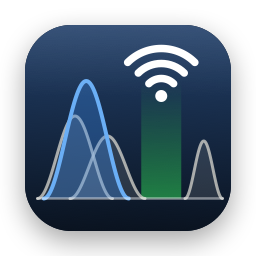

<p align="center"></p>

# WhyFi

**A macOS Wi-Fi analyzer that tells you which channel to put your access point on.**

WhyFi continuously scans the 2.4, 5 and 6 GHz bands with your Mac's own Wi-Fi card, draws every nearby network on a spectrum view, and scores each channel by how much interference it would see. Instead of eyeballing overlapping curves, you get a graded recommendation for each channel width, and you can compare scans taken at different spots in your home to find the channel that works everywhere.

## Features

- **Live spectrum view** for each band. Each network is drawn across the frequencies it actually occupies, with height showing signal strength. Your own network is highlighted, and DFS (radar) channels are shaded.
- **Channel recommendations** for each band and width (20/40/80/160 MHz), graded A–F, with the winner highlighted on the spectrum.
- **Scores averaged over time.** Rank channels by what they're like *now*, or averaged over the last 5 min, 15 min, 1 hour or the whole session. A "peak" figure shows how bad a channel gets when neighbours are busy.
- **Location comparison.** Save the scores at each spot where you use Wi-Fi (kitchen, office, bedroom…), then rank channels by their *worst* location, so the pick is good everywhere.
- **Network table** with SSID, BSSID, vendor, channel, true channel width, signal, Wi-Fi generation, security, and the AP's self-reported channel utilization and client count (when it advertises a BSS Load element).
- **Hidden 6 GHz radios.** Many APs announce their 6 GHz radio only inside their 2.4/5 GHz beacons (Reduced Neighbor Report). WhyFi reads those, so 6 GHz networks your Mac hasn't heard directly still show up.
- **Ignores your own network** when scoring, including guest SSIDs, mesh nodes and the AP's other radios, so your current channel isn't penalized for your own traffic.
- **Connection panel** with your link's signal, noise, SNR, transmit rate and PHY mode, plus signal history graphs for your connection and any selected network.
- **Export** raw scan data as JSON (File ▸ Export Scan Data…).

## How channels are scored

For each candidate channel, WhyFi adds up the power of every neighbouring network that overlaps it. Each neighbour's signal (converted to milliwatts) is weighted by the fraction of its bandwidth that falls inside the candidate channel. The result is expressed as **noise rise**: how many dB that interference lifts the noise floor your AP would hear. The noise floor scales with channel width (+3 dB per doubling), because a wider receiver also collects more background noise.

| Grade | Noise rise |
|---|---|
| A | < 3 dB |
| B | < 8 dB |
| C | < 15 dB |
| D | < 25 dB |
| F | ≥ 25 dB |

Channels within half a dB of each other count as tied. Ties are broken by peak noise rise, then by **contenders** (neighbours at −82 dBm or louder, loud enough to make your AP wait its turn), then by advertised channel utilization, then by preferring non-DFS channels. On 2.4 GHz only channels 1, 6 and 11 are recommended. On 6 GHz only Preferred Scanning Channels are recommended.

WhyFi can only measure what your Mac hears, so run it near where your AP sits, or use the Locations tab to combine several spots. It sees Wi-Fi beacons, not raw RF: non-Wi-Fi interference such as microwaves and Bluetooth needs a spectrum analyzer.

## Requirements

- macOS 26 or later
- Xcode 26 or later (Swift 6.2 toolchain), or the matching Command Line Tools
- A Mac with Wi-Fi. 6 GHz scanning needs a Wi-Fi 6E (or newer) card.

## Building

WhyFi is a Swift package with a small Makefile that assembles and signs the `.app` bundle. No Xcode project is needed.

```sh
git clone <this repo>
cd whyfi
make run      # build, assemble build/WhyFi.app, sign it, and launch it
```

Other targets:

| Command | What it does |
|---|---|
| `make build` | Build `build/WhyFi.app` without launching it |
| `make test` | Run the unit tests (`swift test`) |
| `make icon` | Regenerate `Support/AppIcon.icns` (committed) from `Support/Icon/make-icon.swift` |
| `make clean` | Remove build products |

### Code signing and Location access

macOS hides Wi-Fi network names, BSSIDs and beacon contents from any app that doesn't have **Location Services** permission. WhyFi asks for it on first launch, never reads your location, and doesn't work without it.

macOS ties that permission to the app's code signature, so the Makefile signs the bundle:

- If your keychain has an **Apple Development** certificate (any free Apple ID added in Xcode ▸ Settings ▸ Accounts gives you one), it's used automatically, and the permission survives rebuilds.
- Otherwise the app is signed ad-hoc. It still works, but macOS may ask for Location access again after each rebuild.
- To pick an identity explicitly: `make build IDENTITY="Apple Development: Your Name (TEAMID)"`.

If you denied access, re-enable it in System Settings ▸ Privacy & Security ▸ Location Services, or reset it with `tccutil reset Location com.skidank.WhyFi`.

## Project layout

```
Sources/
  WhyFiCore/   Pure Swift: channel plan, beacon (IE) parsing, network model, scoring, location comparison, vendor lookup
  WhyFiScan/   CoreWLAN scanner and Location permission handling
  WhyFiApp/    SwiftUI app: spectrum, tables, recommendations, locations; bundled OUI vendor list
Tests/
  WhyFiCoreTests/  Unit tests for everything in WhyFiCore
Support/
  Info.plist, AppIcon.icns, Icon/make-icon.swift
```

## Data and privacy

- Scanning happens locally through Apple's CoreWLAN framework. Nothing is sent anywhere.
- Saved locations are stored in `~/Library/Application Support/WhyFi/locations.json`.
- The vendor database (`Sources/WhyFiApp/Resources/oui.tsv`) is derived from the [IEEE MA-L registry](https://standards-oui.ieee.org/).

## Limitations

- CoreWLAN does a full multi-band sweep at most every ~20 seconds and serves cached results in between, so history has roughly 20-second resolution.
- Per-network noise isn't available; scoring uses your connection's noise floor (or −95 dBm when you're not connected).
- Channel utilization and client counts appear only for APs that advertise a BSS Load element.
- The signal of 6 GHz radios that were only *reported* by another AP is estimated. Reported radios on other devices, such as distant mesh nodes, are listed but not scored.
